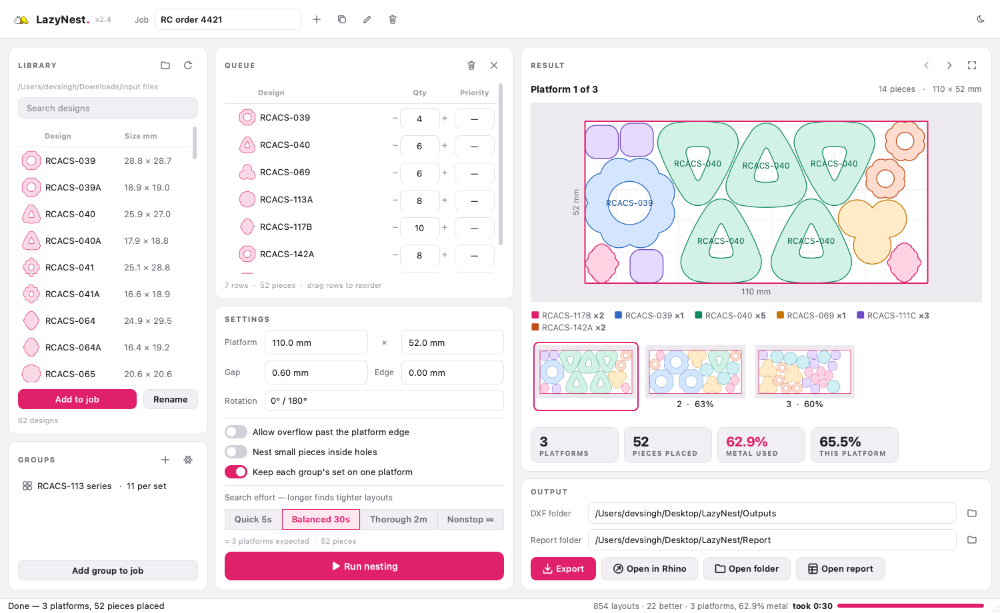

# LazyNest

**Nesting software for jewellery CNC and laser work.** Give it a folder of DXF
designs and a platform size; it packs them by their *true cut outline* and
writes the files your machines read.



Built for gold jewellery production, where a few wasted square millimetres per
sheet is real money. Every design stays one rigid piece — nothing is broken
apart, no geometry is redrawn.

---

## Contents

- [Why it exists](#why-it-exists)
- [Features](#features)
- [Install](#install)
- [Workflow](#workflow)
- [Settings explained](#settings-explained)
- [Library and groups](#library-and-groups)
- [The viewer](#the-viewer)
- [Exports](#exports)
- [Reports](#reports)
- [Where files are written](#where-files-are-written)
- [DXF layer convention](#dxf-layer-convention)
- [How the nesting works](#how-the-nesting-works)
- [Performance](#performance)
- [Troubleshooting](#troubleshooting)
- [Building and releasing](#building-and-releasing)

---

## Why it exists

Most cheap nesting treats every piece as a rectangle. For jewellery motifs —
rings, crescents, scalloped flowers, four-blade swirls — that wastes a third of
the sheet, because the space *between* two curved pieces is exactly where the
next one should go.

LazyNest reads the actual cut line out of each DXF and packs those shapes
against each other. On a real 113-piece job it produced **8 platforms where the
old box-based approach needed 10**.

It also solves the second half of the problem: the nested result has to open
cleanly in the software that drives the machine. Rhino stores circles and arcs
as degree-2 NURBS "splines", which older CAM packages either ignore or explode
into thousands of tiny chords. LazyNest converts them back into real arcs.

---

## Features

### Nesting

- **True-shape packing.** Outlines are built from the cut layer by chaining
  spline, arc and line segments into closed loops. Concave shapes nest inside
  each other's gaps.
- **Margin means the gap between outlines.** Not a box around each piece — the
  real minimum distance between two cut lines, which is your tool clearance.
- **Edge clearance.** A separate minimum distance from the platform edge.
- **Overflow.** Pieces may hang over the platform edge by up to N mm **on each
  side**, set separately for the sides and for top/bottom. Used only when it
  actually saves space.
- **Rotation modes:** 0° only, 0°/180°, every 90°, or free (every 15°). The
  search tunes each piece's angle, not just the running order.
- **Nest inside holes** (optional). Small pieces can sit inside large
  through-holes such as a ring centre.
- **Priority.** Higher-priority designs are placed first, so they land on the
  earliest platforms.
- **Groups (size series).** A group is a recipe — which designs go together and
  how many of each per set, e.g. `A×1, B×6, C×2, D×2`. Each set can be kept on
  one platform, or treated as a convenient way to add designs.
- **Exact verification.** Every layout is re-checked with exact geometry: no
  overlaps, the margin is respected, everything is inside the platform.

### Search

- **Four effort levels:** Quick (~5 s), Balanced (~30 s), Thorough (~2 min) and
  **Nonstop**, which runs until you stop it.
- **Live results.** The viewer updates whenever a better layout is found; the
  status bar shows layouts tried, improvements, the current best and the time
  remaining. **Stop** keeps the best so far, within about half a second.
- **Honest progress.** While the first layout is being packed you get
  "31 of 113 placed · about 40 s left", not a frozen window.

### Output

- **Rhino DXF** — one file per job with every platform side by side, all layers
  and blocks preserved.
- **PRISMA / Solanki set** — R12 DXF, R2004 DXF and SVG, with splines converted
  back to real arcs and circles.
- **Excel reports** — one workbook per day plus a cumulative one, with
  per-platform breakdowns and pictures of each layout.
- **CSV log** of every export.

### Interface

- Light and dark themes.
- Library with shape previews, search, and rename (renames the file on disk).
- Queue with − / + quantity buttons, drag to reorder, group rows that expand.
- Viewer with zoom, pan, hover labels and platform thumbnails.
- The mouse wheel never changes a value — it scrolls.
- Works down to a 900 × 560 window.

---

## Install

### Run from source (Mac, Windows, Linux)

```bash
pip install -r requirements.txt
python app.py
```

Needs Python 3.10+. Dependencies: PyQt6, ezdxf, shapely, pyclipper, numpy,
openpyxl, Pillow.

### Pre-built apps

Grab them from [Releases](../../releases):

| Download | Notes |
|---|---|
| `LazyNest-vX.Y-macOS-arm64.zip` | Apple Silicon. First launch: **right-click → Open** (the app is unsigned) |
| Windows | Run `build_windows.bat` from the build package, or take the `.exe` built by GitHub Actions |

---

## Workflow

1. **Library → folder icon** → choose the folder holding your DXF designs.
   The first scan reads every outline (about 10 s for 60 designs); later scans
   are instant.
2. **Queue the designs.** Double-click a design, or select several and press
   **Add to job**. Rows keep the order you added them and can be dragged.
   Set **Qty** with the − / + buttons, and **Priority** if some pieces must come
   first.
3. **Settings.** Platform size, gap, edge clearance, rotation, overflow, holes
   and search effort.
4. **Run nesting** (`Ctrl+R`). `Esc` stops and keeps the best layout found.
5. **Check the result.** Step through platforms with the thumbnails or ← →,
   scroll to zoom, drag to pan, hover a piece for its name and angle.
6. **Export** (`Ctrl+E`). One button writes the Rhino DXF, the PRISMA / Solanki
   files and both Excel reports. **Open in Rhino**, **Open folder** and
   **Open report** sit next to it.

---

## Settings explained

| Setting | What it does |
|---|---|
| **Platform W × H** | The sheet size in millimetres. |
| **Gap** | Minimum distance between the cut outlines of any two pieces — your tool clearance. Typical: 0.2–0.6 mm. |
| **Edge** | Minimum distance between a piece and the platform border. Default 0, so pieces may touch the edge. |
| **Rotation** | Which angles a piece may be turned to. More angles pack tighter but take longer. |
| **Allow overflow** | Lets pieces reach past the platform edge by the set amount **on each side** — for machines whose work area is slightly larger than the plate. 2 mm means 2 mm on the left *and* 2 mm on the right. |
| **Nest small pieces inside holes** | Allows a small piece to be placed inside a large through-hole of another piece. |
| **Keep each group's set on one platform** | On: a set is never split. Off: the group is only a shortcut for adding designs. |
| **Search effort** | How long to look for a better layout. Nonstop runs until you press Stop. |
| **Priority** (per row) | Higher numbers are placed first, so they end up on the earliest platforms. It does not change the order of the list. |

---

## Library and groups

The library watches one folder, including sub-folders, and caches what it finds
(outline, size, holes, rotational symmetry) so later scans are instant. A design
whose outline could not be read cleanly is flagged in the list.

**Rename** changes both the display name and the file on disk, and updates any
job or group that points at it.

**Groups** are size series. A group holds designs *and a quantity for each*:

```
RCACS-113 series   →   RCACS-113 ×1, RCACS-113A ×6, RCACS-113B ×2, RCACS-113C ×2
```

In the queue, the group's **Qty** is the number of sets. Open the row to change
how many of each design go in one set **for that job only** — set a design to 0
to leave it out. The recipe itself is edited in **Groups → Manage**.

---

## The viewer

- **Scroll** to zoom, **drag** to pan, **double-click** to fit.
- **Hover** a piece to see its design name, rotation and position.
- Thumbnails below show every platform with its fill percentage; click to jump.
- The colour legend lists what is on the current platform and how many.
- The four tiles show platforms, pieces placed, metal used overall, and metal
  used on the platform you are looking at.
- "Metal used" is real outline area (minus holes) over platform area — not a
  bounding-box estimate.

---

## Exports

One **Export** button writes everything.

### Rhino DXF

`<job>.dxf` holds every platform side by side, separated by a gap, with a red
`_PLATFORM_BOUNDARY` outline (and a dashed `_PLATFORM_OVERFLOW` box when
overflow is on). All source layers, linetypes and blocks are preserved. Each
piece is moved by a single rigid transform, so the file matches the viewer
exactly.

### PRISMA / Solanki set

Older CAM software struggles with modern DXF. Rhino writes circles and arcs as
degree-2 rational splines — in these designs that is about **93% of all
curves** — and importers either drop them or shatter them into chords (one
platform flattens to roughly 660,000 vertices).

The CAM export rebuilds the geometry:

| Source | Becomes |
|---|---|
| Degree-2 spline that fits a circle | `CIRCLE` / `ARC` — exact |
| Genuinely freeform spline | A few `ARC`s, within 0.005 mm |
| Polyline / line | `POLYLINE` / `LINE` |

Written as **R12 DXF** (no splines at all — the most widely readable format),
**R2004 DXF**, and **SVG** (1 unit = 1 mm, grouped by layer). Every file is
measured against the original afterwards and the worst deviation is reported in
the status bar — typically **within 5 µm**.

---

## Reports

Two workbooks, updated after every export.

**`<report folder>/2026-11-12.xlsx`** — that day's work:

- One sheet per job: headline figures, the settings used, a designs table
  (requested vs placed, area, share of metal), a platforms table (pieces, metal
  used, overflow used, link to the DXF), and **a picture of every platform**.
- A **Summary** tab for the day.
- A **Design usage** tab for the day.

**`<report folder>/LazyNest_Master.xlsx`** — cumulative across every day: one
Summary row per export ever, and total design usage.

A CSV log of every export is also kept in `lazynest_data/nesting_log.csv`.

---

## Where files are written

```
<output folder>/
    2026-11-12/                     one folder per day
        Rhino/
            RC order 11.dxf         all platforms side by side
            RC order 12.dxf
        Prisma & Solanki/
            RC order 11_R12.dxf
            RC order 11_R2004.dxf
            RC order 11.svg

<report folder>/
    2026-11-12.xlsx                 the day's jobs + Summary + Design usage
    LazyNest_Master.xlsx            cumulative
```

Files are named after the job, so a day's orders sit side by side.
**Open folder** opens that day's folder.

Settings, the library cache and saved jobs live in **`lazynest_data/`** next to
the program (`config.json`, `library.json`, `jobs.json`, `nesting_log.csv`,
`lazynest.log`). Delete it to start fresh — the library folder is remembered in
`config.json` and comes back automatically. Delete it before passing the app to
someone else, so your jobs do not travel with it.

---

## DXF layer convention

| Layer | Used as |
|---|---|
| `0.5_Out`, or any layer whose name contains "out" | The cut outline — this is the nesting shape |
| `0.5_In`, `*_In`, `*_inner`, `*_hole` | Through-holes |
| Everything else | Copied through untouched (engraving, ball dots, …) |

If no outer layer exists, the outline is built from all closed geometry. If
nothing closes at all, the convex hull is used and the design is flagged in the
library.

**Gaps are tolerated.** Some CAD exports leave the cut outline a hair open.
Gaps up to 2 mm are closed automatically, but only between two loose ends that
are each other's nearest neighbour, and only when closing them genuinely
recovers the shape.

---

## How the nesting works

1. **Outline.** Each design's cut layer is flattened and chained into closed
   loops. Holes are kept separately.
2. **Collision shapes.** Each outline is offset by half the gap and split into
   convex parts. For a pair of designs at a given relative angle, a *no-fit
   polygon* says exactly where one may not sit relative to the other.
3. **Placement.** For each piece, the feasible region is
   `platform − ∪ (no-fit polygons of everything already placed)`. The best
   vertex of that region is chosen — tightest first, gravity along the
   platform's long axis — over every allowed angle.
4. **Search.** The running order and the per-piece angles are mutated within
   your time budget, keeping the best layout: fewest platforms first, then most
   compact.
5. **Check.** The winning layout is re-tested with exact geometry.

Three things keep it fast:

- **Symmetry.** A design's rotational symmetry is measured once during the
  library scan. Angles that produce an identical shape are skipped — on a real
  library that cuts the work to 41%.
- **Shared work.** Each design pair is computed once; the mirrored side and the
  rotated variants are derived from it.
- **A complexity cap.** Very wiggly outlines (prongs, scallops) are matched with
  fewer, slightly larger convex parts, because collision cost grows with the
  *square* of that count. Parts only ever grow outward, so the gap you set is
  never undercut.

---

## Performance

Measured on an M-series Mac with a 62-design library:

| Job | Time |
|---|---|
| Library scan, 62 designs | ~11 s once, then instant |
| 113 pieces, 0°/180°, Quick | ~5 s |
| 113 pieces, free rotation, Quick | ~12 s |
| 52 pieces of heavy CAD files (7,000-vertex outlines) | ~20 s |
| Export (DXF + R12 + R2004 + SVG + reports), large job | ~40 s |

Tips:

- **0°/180° is much faster than free rotation** and usually nearly as tight.
- The first run of a job does the geometry work; re-runs reuse it.
- Nonstop, plus the "nothing better for a while" hint in the status bar, is the
  cheapest way to know when to stop.

---

## Troubleshooting

**A design looks wrong in the library preview.** Its outline could not be read
from the cut layer. Check that the cut geometry is on `0.5_Out` (or a layer with
"out" in the name) and that it forms closed loops.

**"Did not fit" on pieces that should fit.** The piece is larger than the
platform at every allowed angle. Compare the size shown in the library with your
platform, and try more rotation angles.

**Export says files could not be written.** The Excel report is open in Excel —
close it and export again. The DXFs are still written.

**macOS: "cannot be opened because the developer cannot be verified".** The app
is unsigned. Right-click it → **Open** → **Open**. Only needed once.

**Windows: "Windows protected your PC".** Same reason. **More info → Run
anyway**.

**Something crashed.** `lazynest_data/lazynest.log` has the details.

**Exporting from Rhino 8 for other software.** Use the `R12 Natural` or
`2004 Lines/Arcs` scheme rather than the default, and tick *Project to
construction plane*. LazyNest's own CAM export already does the equivalent.

---

## Building and releasing

**macOS**

```bash
pip install -r requirements.txt pyinstaller
python -m PyInstaller LazyNest.spec        # → dist/LazyNest.app
```

**Windows**

```cmd
build_windows.bat                           :: → dist\LazyNest.exe
```

A Windows `.exe` can only be built on Windows — PyInstaller cannot cross-build.

**GitHub Actions.** `.github/workflows/build.yml` builds both the Windows `.exe`
and the macOS app on GitHub's runners. Run it from the **Actions** tab, or push
a `v*` tag. The finished apps appear as downloadable artifacts, ready to attach
to a release.
